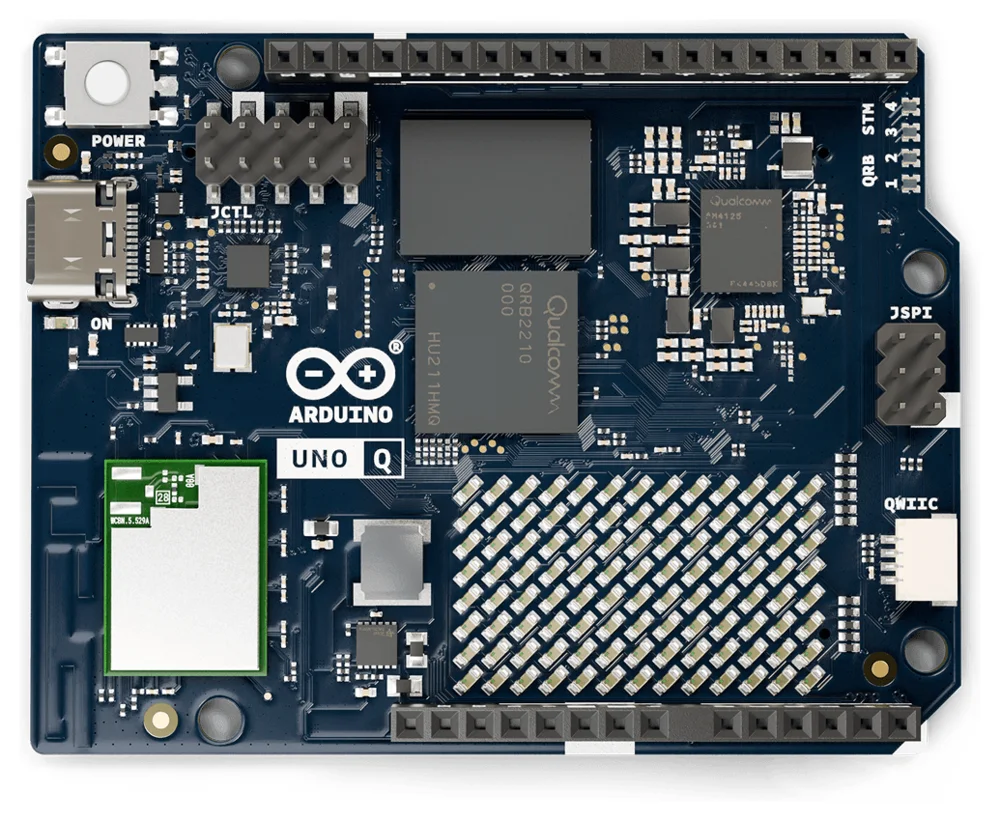

# Arduino UNO Q System

This is the base Nerves System configuration for the
[Arduino UNO Q](https://docs.arduino.cc/hardware/uno-q).


<br><sup>Image from the [Arduino documentation](https://github.com/arduino/docs-content), [CC-BY-SA-4.0](https://creativecommons.org/licenses/by-sa/4.0/)</sup>

| Feature        | Description                                         |
| -------------- | --------------------------------------------------- |
| CPU            | Qualcomm QRB2210, quad-core Cortex-A53              |
| Memory         | 2 GB or 4 GB LPDDR4                                 |
| Storage        | 16 GB or 32 GB eMMC                                 |
| Linux kernel   | Mainline 7.2                                        |
| Bootloader     | Arduino's U-Boot fork, loaded by Qualcomm's ABL     |
| IEx terminal   | UART `ttyMSM0`                                      |
| USB            | Ethernet gadget (`usb0`) for `mix upload`           |
| GPIO, I2C, SPI | Yes - [Elixir Circuits](https://github.com/elixir-circuits) |
| WiFi           | Yes - VintageNet (ath10k WCN3990)                   |
| Bluetooth      | WCN3988, `hci0` comes up (otherwise untested)       |
| MCU            | STM32U585 via `arduino-router` and `unoq-mcu`       |
| GPU            | Adreno 702 kernel driver only - no Mesa userspace   |
| Display        | Kernel DRM/KMS with USB-C DisplayPort (untested)    |
| Video codec    | No - Venus fails to probe (see below)               |
| Audio          | No - not supported by the mainline device tree      |
| Camera, ISP    | No - not supported by the mainline device tree      |
| DSP            | ADSP runs, but nothing uses it yet                  |

This system is a work in progress.

## Using

Add the system to your Nerves project's dependencies with a target of your
choosing, for example `uno_q`:

```elixir
@all_targets [:uno_q]

defp deps do
  [
    # ...
    {:nerves_system_arduino_uno_q,
     github: "jimsynz/nerves_system_arduino_uno_q",
     tag: "v0.1.0",
     runtime: false,
     targets: :uno_q}
  ]
end
```

Nerves downloads the prebuilt system from the matching GitHub release. Then
build firmware with `MIX_TARGET=uno_q mix firmware`. See the
[Nerves getting started guide](https://hexdocs.pm/nerves/getting-started.html)
for setting up a project.

## Installing Nerves on a board

The first install, or a recovery, goes over USB using the QRB2210's Emergency
Download (EDL) mode, which is built into the chip. It works whatever is on the
eMMC, including Arduino's Debian image.

> **Warning:** provisioning erases the eMMC, including Arduino's Debian image and anything
> stored on it. To go back to Debian, flash Arduino's image with
> [`arduino-flasher-cli`](https://github.com/arduino/arduino-flasher-cli).
> The MCU's flash isn't touched.

You need [`fwup`](https://github.com/fwup-home/fwup#installing) installed. If
[`qdl`](https://github.com/linux-msm/qdl) isn't on your `PATH`,
`mix firmware.qdl` downloads Arduino's prebuilt `qdl` the first time, along
with Arduino's eMMC bootloader bundle.

On Linux, let your user access the board in EDL mode (USB `05c6:9008`) and keep
ModemManager away from it with a udev rule, for example in
`/etc/udev/rules.d/70-arduino-uno-q-edl.rules`:

```text
SUBSYSTEMS=="usb", ATTRS{idVendor}=="05c6", ATTRS{idProduct}=="9008", MODE="0660", GROUP="plugdev", ENV{ID_MM_DEVICE_IGNORE}="1"
```

Then run `sudo udevadm control --reload-rules && sudo udevadm trigger`. Use a
group your user is in if your distribution doesn't have `plugdev`.

To install:

1. Build the firmware: `MIX_TARGET=uno_q mix firmware`
2. Run `MIX_TARGET=uno_q mix firmware.qdl`. It prepares everything, then
   waits for the board.
3. Unplug the UNO Q's USB-C cable.
4. Connect `GND` to `USB_BOOT` with a jumper or a wire. They're the two pins
   in the rightmost column of the JCTL header.
5. Plug the USB-C cable back in, directly into your computer. `mix
   firmware.qdl` notices the board and flashes it, which takes a minute or two.
6. Unplug the USB-C cable, remove the jumper and plug the cable back in. The
   board boots Nerves.

After that, update the board over USB networking or WiFi with `mix upload`.

### Troubleshooting

* If `mix firmware.qdl` never sees the board, check the jumper and that it was
  fitted before the cable was plugged in. In EDL mode the board shows up as
  `05c6:9008` in `lsusb`.
* If `qdl` can't open the device, check the udev rule. If the `qcserial`
  kernel module has claimed the board (it shows up as `/dev/ttyUSB*`), unload
  it with `sudo modprobe -r qcserial` or blacklist it.
* If flashing fails partway through, use a different USB port or cable. Hubs,
  docks and some USB 3 ports cause trouble.

## Boot chain

Qualcomm's boot firmware (PBL, XBL, ABL) is left as Arduino ships it. ABL loads
U-Boot from the Android boot image in the `boot_a` partition. U-Boot keeps its
environment in the eMMC at 4 MiB and uses the standard Nerves A/B logic to load
the kernel and device tree from a FAT boot partition. U-Boot also adds the
board's WiFi MAC and Bluetooth addresses to the device tree.

## eMMC layout

Partitions 1 to 66 are Qualcomm's and are never written by Nerves. The Nerves
partitions replace Arduino's `efi`, `rootfs` and `userdata` partitions at the
end of the GPT:

| Partition | Name     | Contents                         |
| --------- | -------- | -------------------------------- |
| 67        | boot_a   | FAT: `Image`, device tree        |
| 68        | boot_b   | FAT: `Image`, device tree        |
| 69        | rootfs_a | squashfs root filesystem         |
| 70        | rootfs_b | squashfs root filesystem         |
| 71        | data     | f2fs application data            |

fwup can't write a GPT with this many entries, so `mix firmware.qdl` writes
the partition table and fwup only writes inside it. The offsets in
`fwup_include/fwup-common.conf` must match `lib/nerves_system_arduino_uno_q/qdl.ex`;
the tests check that they do.

The eMMC's `boot0` hardware partition holds the board's WiFi MAC address,
Bluetooth address and board revision. U-Boot reads them; nothing in Nerves
writes to `boot0`.

## WiFi and the modem

The WiFi firmware runs on the QRB2210's modem remote processor. Before the
modem can boot it needs two helpers from
[linux-msm](https://github.com/linux-msm): `rmtfs`, which serves the modem's
storage partitions (read-only) and then starts the modem, and `tqftpserv`,
which serves it the WiFi firmware. `/usr/sbin/uno-q-init` starts both from
erlinit's `--pre-run-exec`, before the Erlang VM starts, and restarts them if
they exit. `wlan0` appears about 13 seconds after power on.

## The STM32U585 MCU

`uno-q-init` also runs Arduino's
[arduino-router](https://github.com/arduino/arduino-router), the MsgPack-RPC
link to the MCU over `/dev/ttyHS1`, as Arduino's Debian image does. Programs
talk to the MCU through `/var/run/arduino-router.sock`. When the router is
ready it raises GPIO 70, which tells the MCU that Linux is up.

The MCU is flashed over SWD, bit-banged from the QRB2210's GPIOs by OpenOCD.
`unoq-mcu` wraps the common operations:

```sh
unoq-mcu animation                      # install the Nerves boot animation
unoq-mcu sketch loader.elf sketch.bin   # flash a loader and sketch
unoq-mcu dump /tmp/mcu.bin              # read the MCU's flash
unoq-mcu reset
```

The MCU's loader plays a boot animation on the LED matrix until GPIO 70 goes
high. `unoq-mcu animation` replaces Arduino's animation with a Nerves logo.

To run your own sketch, build it with `arduino-cli compile -b arduino:zephyr:unoq`
and flash the core's loader (`firmwares/zephyr-arduino_uno_q_stm32u585xx.elf`)
with the sketch's `.elf-zsk.bin`:

```sh
unoq-mcu sketch zephyr-arduino_uno_q_stm32u585xx.elf my_sketch.ino.elf-zsk.bin
```

Sketches using [Arduino_RouterBridge](https://github.com/arduino-libraries/Arduino_RouterBridge)
can then provide and call methods through the router, as they do on Arduino's
Debian image.

## Multimedia and accelerators

The mainline kernel and device tree support less of the QRB2210 than
Arduino's kernel fork does:

* **GPU** (Adreno 702): the `msm` DRM driver binds, loads its firmware and
  provides `/dev/dri/renderD128`. The system has no Mesa, so there's no
  OpenGL ES or Vulkan.
* **Display**: the display controller, DSI and the ANX7625 bridge for
  DisplayPort over USB-C come up as DRM `card0` with a `DP-1` connector. It
  hasn't been tested with a monitor, and nothing in the system drives it.
* **Video codec** (Venus, AR50-Lite): the driver asks for
  `qcom/venus-6.0/venus.mbn`, which isn't installed, so it fails to probe.
  linux-firmware's AR50-Lite firmware is `qcom/vpu/ar50lt_p1_gen2_s6.mbn`.
  While the codec is unprobed, the clock controller and interconnects never
  finish their `sync_state`, so unused clocks and bandwidth stay enabled.
* **Audio**: the ADSP remote processor boots, but the mainline device tree
  has no sound card, so there's no ALSA playback or capture.
* **Camera and ISP**: CAMSS is disabled in the mainline device tree and the
  OPE image signal processor driver only exists in Arduino's kernel.
* **DSP compute**: `/dev/fastrpc-adsp` exists, but the system has no FastRPC
  library or Hexagon runtime. The QRB2210 has no separate compute DSP.

Audio, camera and the ISP need Arduino's out-of-tree kernel patches.
